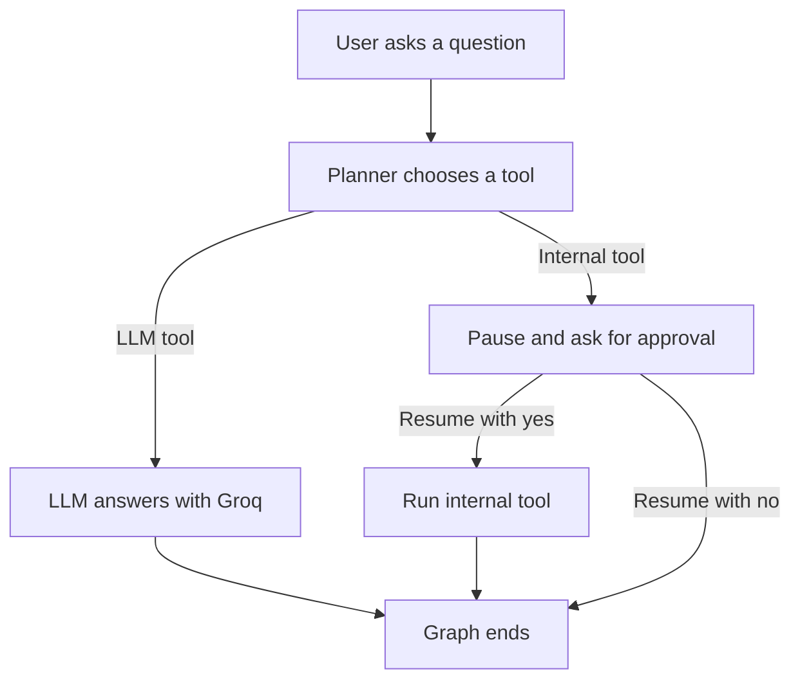

# Human-in-the-Loop Agent with LangGraph

A small learning project that demonstrates how a LangGraph agent can pause for human approval before using an internal tool. It also shows how an interrupted graph can resume with the human's decision.

## What you'll learn

- How to create a graph from nodes, edges, and conditional routes.
- How a planner can choose which tool to use.
- How LangGraph's `interrupt()` pauses execution for human input.
- How `Command(resume=...)` continues the graph with that input.
- How a checkpointer keeps graph state available across the pause and resume.

## How it works



The graph uses a thread ID and an in-memory checkpointer to keep its state while waiting for approval. The human's answer is passed back to the paused graph using `Command(resume=decision)`.

## Technologies and concepts

- **Python 3.12+**
- **LangGraph** for graph-based workflows, interrupts, resume commands, and checkpointing
- **Groq** for the LLM-powered planner and answer node
- **python-dotenv** for loading local environment variables
- **Human-in-the-loop (HITL)** approval before a tool runs

## Run it locally

### 1. Get the project

Clone your repository and open a terminal in its folder.

### 2. Create and activate a virtual environment

```powershell
py -3.12 -m venv .venv
.\.venv\Scripts\Activate.ps1
```

### 3. Install dependencies

```powershell
python -m pip install groq langgraph python-dotenv
```

### 4. Configure Groq

Create a `.env` file in the project folder:

```env
GROQ_API_KEY=your_groq_api_key
GROQ_MODEL_NAME=your_groq_model_name
```

Replace the placeholder values with your own Groq API key and a model available to your account. Keep `.env` private: it is excluded from Git, so do not commit your real credentials.

### 5. Start the agent

```powershell
python main.py
```

## Example

An ordinary question is routed to the LLM node:

```text
USER: what is aws in 50 words
AI: AWS (Amazon Web Services) is a cloud platform offering scalable computing, storage, databases, and networking...
```

A question routed to the internal tool pauses and asks for approval:

```text
USER: give me leave policy of my company ?
====================
Human Approval Required
====================
Approve this tool call?
internal_tool
approve? yes/no: yes
AI: internal tool has been executed
```

If you answer `no`, the graph ends without running the internal tool. LLM responses can vary between runs.

## Limitations and future scope

The internal tool is currently a placeholder: it returns a fixed message rather than retrieving real employee or company data. The checkpointer stores state only in memory, so a persistent checkpointer could be added to retain it across process restarts.
